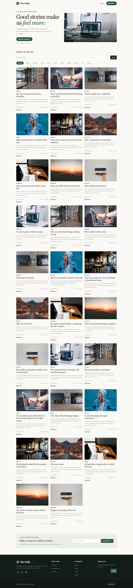

# 📝 The Daily — Blog Website

A responsive blog website built with **React** and **Vite**. Readers can browse blog posts, search for articles, filter posts by tags, and view individual article details.

## ✨ Features

- 📰 **Featured Article** — Highlights a selected story on the homepage.
- 🔎 **Search Blogs** — Find posts using the search feature.
- 🏷️ **Tag Filters** — Filter articles by available tags.
- 📖 **Blog Details Page** — Read an individual post on its own page.
- ⏱️ **Reading Time** — Shows an estimated reading time for articles.
- 📊 **Post Information** — Displays available tags, views, and reactions.
- 📱 **Responsive Design** — Layout adapts to desktop, tablet, and mobile screens.
- ⏳ **Loading and Error States** — Displays feedback while posts are loading or if a request fails.
- ✉️ **Newsletter Demo** — Shows a confirmation message; subscriptions are not actually saved or sent.

## 🛠️ Built With

- **React** — Builds the user interface.
- **Vite** — Development server and build tool.
- **React Router** — Handles page navigation.
- **Axios** — Makes API requests.
- **Tailwind CSS and CSS** — Styling.
- **DummyJSON Posts API** — Supplies sample blog content.

## 🚀 Getting Started

### Prerequisites

- Install [Node.js](https://nodejs.org/).
- npm is included with Node.js.

### Installation

1. **Download or clone** this project.
2. Open a terminal in the project folder.
3. Install the dependencies:

   ```bash
   npm install
   ```

4. Start the development server:

   ```bash
   npm run dev
   ```

5. Open the local URL shown in your terminal. Vite usually uses `http://localhost:5173`.

## 📜 Available Commands

| Command | What it does |
| --- | --- |
| `npm run dev` | Starts the local development server. |
| `npm run build` | Creates the production build in the `dist` folder. |
| `npm run preview` | Runs a local preview of the production build. |
| `npm run lint` | Checks the project with ESLint. |

## 🗺️ Pages and Routes

- `/` — Homepage with the featured story, search, and tag filters.
- `/blog/:id` — Details page for the selected blog post.
- `*` — Fallback route for unknown pages.

## 📁 Project Structure

```text
Blog Website/
├── public/
│   ├── favicon.svg
│   └── icons.svg
├── src/
│   ├── assets/                 # Images and static assets
│   ├── components/
│   │   ├── BlogCard.jsx        # Blog preview card
│   │   ├── Footer.jsx          # Website footer
│   │   ├── Hero.jsx            # Featured article section
│   │   └── Navbar.jsx          # Navigation bar
│   ├── data/
│   │   └── blog.js             # Cover images and reading-time helper
│   ├── pages/
│   │   ├── Home.jsx            # Homepage, search, and filters
│   │   └── BlogDetails.jsx     # Individual blog page
│   ├── services/
│   │   └── api.js              # API request functions
│   ├── App.jsx                 # App layout and routes
│   ├── App.css                 # App styles
│   ├── index.css               # Global styles
│   └── main.jsx                # React entry point
├── index.html
├── package.json
├── vite.config.js
└── README.md
```

## 🌐 API Used

This project uses the [DummyJSON Posts API](https://dummyjson.com/posts) for sample content.

- `GET /posts?limit=30` — Loads blog posts.
- `GET /posts/{id}` — Loads a single blog post.
- `GET /posts/search?q={query}` — Searches blog posts.

The website needs an internet connection to fetch post data and load remote cover images.

## 📸 Screenshots



## ⚠️ Notes

- Blog content comes from a demo API; this project does not currently use its own backend or database.
- The newsletter form is a frontend demo and does not store email addresses.
- If posts do not load, check your internet connection and try again.

## 👨‍💻 Development Checks

Before publishing your changes, run:

```bash
npm run lint
npm run build
```

---

